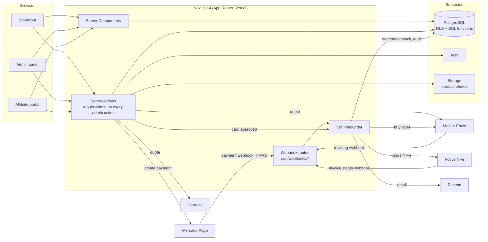

# fashion-ecommerce-erp

[](https://github.com/leonardo-merlo/fashion-ecommerce-erp/actions/workflows/ci.yml)

Online store with a built-in production ERP for a handmade fashion brand: customers buy on the storefront, and the owner manages stock, raw materials, production orders, wholesale orders and invoices in the same app. Built for a real small business in Brazil, which runs it in production.

> Developed over ~6 months (since May 2026) in a private production repository (190+ commits). This is a sanitized snapshot: the client's brand, catalog, photos and business data were replaced with a fictional brand, **Ateliê Exemplo**. Product photos are from [Unsplash](https://unsplash.com/license).

<!-- Screenshots / GIF: storefront, admin dashboard, production order blocked by missing material -->

## The problem

The owner ran stock on spreadsheets and wholesale orders through WhatsApp labels, with no online store. Bags are made in-house from pre-cut pieces of canvas, lining and leather in many colors, so "can I make 10 more of this bag?" was answered by counting pieces by hand.

## What it does

**Storefront (B2C)**
- Catalog by category, product pages with variants (size/color), out-of-stock variants shown as sold out
- Cart and checkout with Mercado Pago: PIX, credit card and boleto
- Shipping quotes from Melhor Envio and from the Correios contract API, address autofill via ViaCEP
- Coupons (percent/fixed, minimum order, global and per-customer limits), guest checkout or customer account, wishlist, order history, public order status page
- Affiliate program: affiliate portal with personal coupon and commission tracking

**Admin panel (single operator)**
- Products and variants with photo upload and CSV import; stock adjustments with an audit trail
- Raw materials by category and color, bill of materials per product, production color per cut piece per variant
- Production orders: material check, completion that consumes materials and adds finished stock in one transaction, revert
- Retail and wholesale orders, customers, suppliers, accounts payable, affiliates, sales reports, store settings and an integration diagnostics page

**After payment** (one idempotent step, triggered by the payment webhook or by an instantly approved card)
- Stock decrement, coupon usage, shipping label purchase, NF-e (Brazilian e-invoice) issuance through Focus NFe and confirmation email through Resend

**Planned**
- WhatsApp order notifications
- Stock per location (shipping from more than one address)

## Architecture



## Tech stack

- **App:** Next.js 14 (App Router, Server Components, Server Actions), React 18, TypeScript (strict)
- **UI:** Tailwind CSS 3, Radix UI primitives (shadcn/ui style), Leaflet
- **Data:** Supabase (PostgreSQL, Auth, Storage), Row Level Security, business rules in PL/pgSQL functions, 48 SQL migrations
- **Integrations:** Mercado Pago SDK, Resend; REST clients for Melhor Envio, Correios, Focus NFe and ViaCEP
- **Testing:** Vitest (unit), SQL tests on PostgreSQL 17, Playwright (E2E)
- **CI:** GitHub Actions

## Key technical decisions

**Stock moves only inside the database.** Completing a production order (`complete_production_order`) checks, in order, that every cut piece has a defined color, that the material exists in that color, and that there is enough of it. Only then does it subtract each material and add finished stock, in one transaction, writing an audit row per line. `revert_production_order` undoes it exactly and refuses if the finished piece was already sold. Doing this in SQL instead of in the app means a failure halfway cannot leave materials consumed without finished goods. See the latest definitions in `supabase/migrations/036_fix_undefined_color_guard.sql` and `supabase/tests/production-orders.test.sql`.

**A recipe per product, a color per piece per variant.** Bags share cut pieces ("canvas front") across models, and the color changes per variant. The bill of materials stores only category + piece for cut items; the color comes from `variant_cut_colors`, keyed by `(variant, category, piece)`. A composite foreign key to the color palette makes it impossible to save a color that is not in the palette, which used to break recipes silently when colors were free text. `resolve_variant_bom()` is the single function that turns a variant into its material list.

**Post-payment work runs once, and each step fails alone.** A payment can be confirmed by the Mercado Pago webhook and by the checkout itself (card approved instantly). `fulfillPaidOrder` starts with a conditional update (`payment_status <> 'paid'`) that only one caller can win, so a duplicate webhook does nothing. After that, stock, coupon, label, invoice and email are each isolated: a failed label purchase does not stop the invoice, and the reason is stored on the order (`shipping_error`, `nfe_error`) so the owner sees why, not just that it failed. Webhook payloads are trusted only after HMAC (`timingSafeEqual`) or token validation.

**Orders keep a snapshot of the buyer.** Checkout updates the customer record on every purchase, so reading the name through a join rewrote history: renaming a customer changed old orders, including ones with an invoice already issued under the previous name. Orders now store `buyer_name`, `buyer_cpf_cnpj`, `buyer_address` and so on at purchase time, the same rule already applied to `order_items.unit_price`.

**Fiscal address and shipping origin are different things.** The company's registered address decides the invoice's CFOP (in-state vs. interstate sale code); the place the parcel leaves from decides the shipping quote. They used to be the same environment variables. They are now separate fields, read through one module: invoice issuance fails closed when the fiscal address is incomplete, while the shipping origin falls back to the previous values, because stopping sales is worse than quoting from yesterday's address. Quote and label purchase call the same function, so they can no longer disagree.

## Testing

| Layer | Where | How to run | In CI |
|---|---|---|---|
| Unit | `lib/**/*.test.ts` (Vitest) | `npm test` | yes |
| Database | `supabase/tests/*.test.sql` | `npm run test:db` | yes |
| E2E | `e2e/*.spec.ts` (Playwright) | `npm run test:e2e` | no |
| Static | ESLint, TypeScript | `npm run lint`, `npm run typecheck` | yes |

**Unit tests.** Vitest, next to the file they test, on the pure functions where a wrong answer costs money or a rejected invoice: the NF-e payload (CFOP per item, totals rounded to cents, CPF vs. CNPJ fields, flat emitter fields, missing NCM or address), CPF/CNPJ/CEP validation, the shipping option id that travels through the browser, how cart items are packed into one parcel, and reading env values pasted with an inline comment.

**Database tests.** `scripts/test-db.sh` creates a throwaway PostgreSQL database, applies the Supabase stubs (`supabase/tests/supabase-stubs.sql`), all migrations and the seed, then runs each `*.test.sql`. Each test runs in a transaction that is rolled back and fails the run on the first broken assertion. They cover production order completion and revert, the refusal paths (missing material, undefined color, unregistered material, double completion, revert after sale) and sale/return stock movements. Needs a local PostgreSQL reachable through the usual `PGHOST`/`PGUSER`/`PGPASSWORD` variables, with a user that can create databases and roles.

**E2E tests.** Three Playwright specs drive the admin panel: create a product with variant, photos and bill of materials; refuse a variant without the color its recipe needs; create a wholesale order with notes; feature a product on the home page. They need the app running against a Supabase project and an admin user (`E2E_ADMIN_EMAIL`, `E2E_ADMIN_PASSWORD`); without those they skip. They are not run in CI.

## Getting started

Requirements: Node.js 20, `psql`, and a Supabase project (the free tier is enough; a local stack from the Supabase CLI also works).

```bash
git clone https://github.com/leonardo-merlo/fashion-ecommerce-erp.git
cd fashion-ecommerce-erp
npm ci
cp .env.example .env.local
```

Load the schema and the demo store into the project's database. `DATABASE_URL` is the connection string from the Supabase dashboard (Connect → Session pooler):

```bash
for f in supabase/migrations/*.sql; do psql "$DATABASE_URL" -v ON_ERROR_STOP=1 -f "$f"; done
psql "$DATABASE_URL" -v ON_ERROR_STOP=1 -f supabase/seed.sql
```

Fill `NEXT_PUBLIC_SUPABASE_URL`, `NEXT_PUBLIC_SUPABASE_ANON_KEY` and `SUPABASE_SERVICE_ROLE_KEY` in `.env.local` (dashboard → Project Settings → API), then:

```bash
npm run dev
```

The storefront is at http://localhost:3000. For the admin panel, sign up a user, then set its role in the SQL editor: `update user_profiles set role = 'admin' where id = '<user id>';`. Payments, shipping, invoices and email need sandbox credentials for each provider in `.env.local`; without them those features stay off.

## Glossary

The domain is Brazilian and the code keeps Portuguese names for business terms.

| Code | Meaning |
|---|---|
| `estoque` | stock |
| `materias`, `raw_materials` | raw materials |
| `corte` (Corte Lona / Forro / Couro) | pre-cut piece of canvas / lining / leather |
| `ficha técnica`, `bill_of_materials` | bill of materials (recipe) |
| `OP`, `producao`, `production_orders` | production order |
| `pedido` | order |
| `atacado` / `varejo` | wholesale / retail |
| `NF-e`, `nota` | Brazilian electronic invoice |
| `CFOP` | invoice operation code (in-state 5102 vs. interstate 6102) |
| `frete`, `etiqueta` | shipping, shipping label |
| `afiliada` | affiliate |
| `cupom` | coupon |
| `financeiro` | accounts payable |
